# DS Bot Go

在手机上继续使用电脑里的 DS Bot 团队。

DS Bot Go 是基于 [DSH Go](https://github.com/ccch1mneyyy/dsh-Go)、[DS Bot](https://github.com/Fei2411/DS-Bot) 和 [DS Harness Remote](https://github.com/liguobao/ds-harness-remote) 的社区衍生增强项目，底层使用 [DeepSeek Harness](https://github.com/deepseek-ai/deepseek-harness)。项目使用自己的 Bot 图标和素材，不代表上游或 DeepSeek 官方。

[下载安装包](https://github.com/tangchunhao71-hash/DS-Bot-Go/releases/latest) · [详细安装教程](docs/INSTALL_WINDOWS.zh.md) · [安装与构建](docs/GETTING_STARTED.md) · [来源与许可](docs/LICENSING.md) · [反馈问题](https://github.com/tangchunhao71-hash/DS-Bot-Go/issues) · [English](README.en.md)

## 可以做什么

- **继续使用原团队。** 手机通过 DSH Remote 连接电脑主机，进入已有的 Bot、团队和会话。
- **原生移动工作区。** 查看团队、待处理事项和会话，在手机上搜索、筛选并调整分区显示。
- **复用已有能力。** 支持头像预览与保存、记忆和用量等接口，以及既有定时任务的查看、新建和确认删除。具体可用项取决于电脑端组件版本与权限。
- **保持受控连接。** 配套移动 API 与 Remote 通道校验身份、限制调用范围，并避免自动重放结果未知的写入。
- **自有 Bot 形象。** 蓝白原创图标和对应素材，延续友好的 Bot 视觉语言。

## 安装

常见 Android 手机从 [Releases](https://github.com/tangchunhao71-hash/DS-Bot-Go/releases/latest) 下载 `DS-Bot-Go-1.0.12-arm64.apk`，在手机上点开安装。初版面向 Android 8 及以上的 arm64 设备。

一个 APK 即可安装；**远程使用 DS Bot 时，电脑仍需运行 DS Bot 与兼容的 Remote Host，并保持在线。** 安装包不包含模型账号、API Key 或他人的 Bot 数据。按自己的账号与服务完成连接。

手机不需要先装 DSH Go。新电脑需要本项目配套的 DS Bot 和 Remote 改版；1.0.12 尚未提供电脑端一键安装器，完整步骤见 [Windows + Android 安装教程](docs/INSTALL_WINDOWS.zh.md)。

已经安装本项目兼容测试版的用户，应先核对发行说明中的包名和签名。不要为解决签名不一致而直接卸载有数据的旧版。

## 源码布局

| 目录 | 内容 | 主要许可 |
| --- | --- | --- |
| `mobile/` | DSH Go 衍生 Android 客户端与构建输入 | AGPL-3.0，第三方条目另见声明 |
| `desktop/ds-bot/` | DS Bot 0.2.7 基线与移动 API 改进 | Apache-2.0 |
| `desktop/remote/` | DS Harness Remote 与 DS Bot 通道适配 | MIT，第三方条目保留 |
| `branding/` | 本项目原创 Bot 图标、SVG 与生成脚本 | MIT |
| `tools/` | 本项目发布与源码核对工具 | MIT |

固定来源提交见 [UPSTREAMS.json](UPSTREAMS.json)，本项目的主要变化见 [MODIFICATIONS.md](MODIFICATIONS.md)。发行 APK 的源码和构建说明随同一版本提供。

## 参与和许可

欢迎通过 Issue 反馈问题和建议。当前**不接收、不合并外部 PR**；维护者的内部变更仍可使用 PR。详见 [CONTRIBUTING.md](CONTRIBUTING.md)。这项维护政策不限制许可证授予的使用、修改、分发或 Fork 权利。

DSH Go 衍生客户端继续按 AGPL-3.0 提供；独立原创图标与发布工具使用 MIT。DS Bot、Remote 及其他第三方代码保留各自许可证、署名和声明，不能把整个项目概括为纯 MIT。详见 [许可范围](docs/LICENSING.md) 与各组件目录的原许可文件。

感谢各上游维护者和贡献者。本项目的独立发行、改动和支持由 DS Bot Go 维护者负责。
